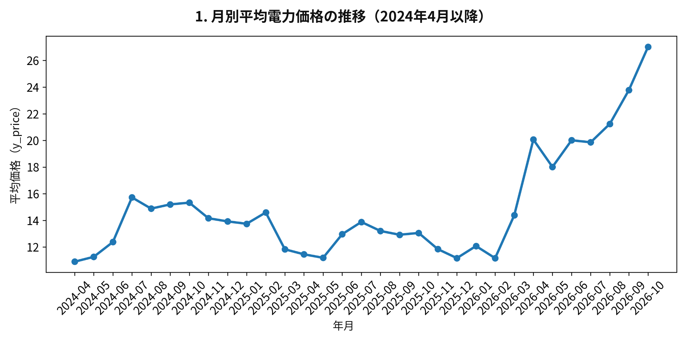
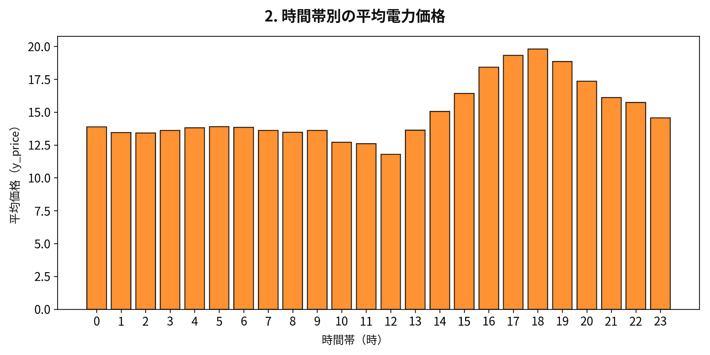
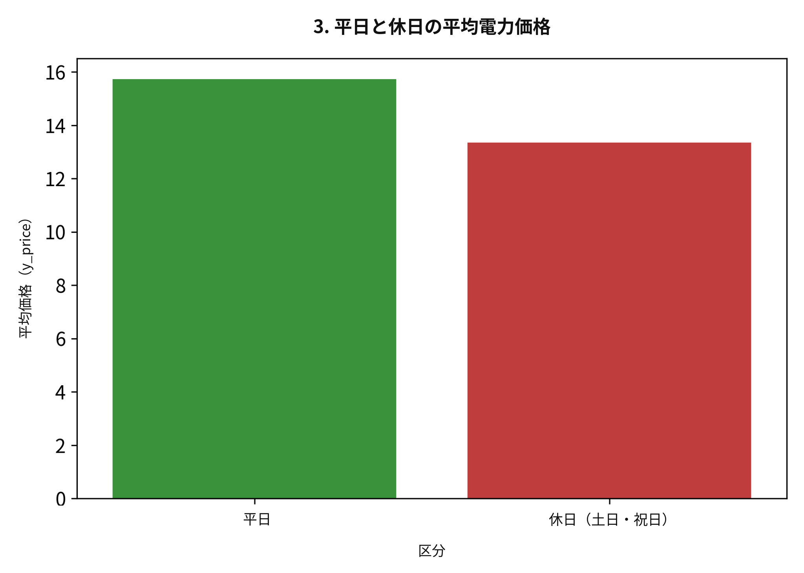
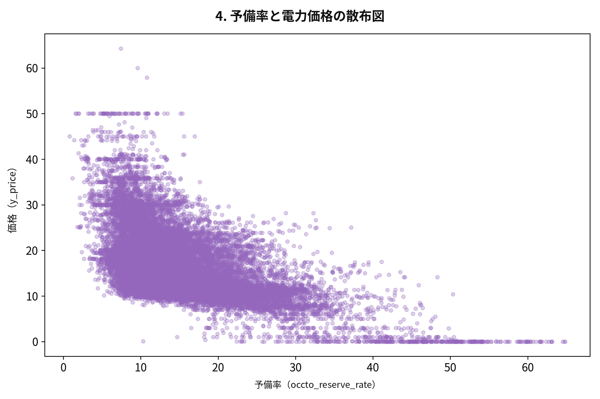

# ⚡ JEPX電力価格予測プロジェクト — 探索的データ分析（EDA）レポート（11月16日）

本レポートは、`merged_30min.csv`を使用し、**電力価格（`y_price`）がいつ、どのような条件で上昇するのか**を把握するために実施した、初期段階の探索的データ分析（EDA）をまとめたものです。

---

## 📊 分析サマリー（Executive Summary）

- **月別推移：** **2026年4月以降**、平均電力価格が大きく上昇する傾向が見られます。
- **時間帯別の傾向：** 太陽光発電量の多い**昼の12時前後に低く**、日没後の需要が集中する**18時前後に高い**傾向があります。
- **曜日・休日別の違い：** 産業・商業需要のある**平日**の平均価格は、土日・祝日より高くなっています。
- **需給状況：** 電力の予備率（`occto_reserve_rate`）が低い領域ほど、高い価格が観測される傾向があります。

---

## 📈 詳細分析と可視化

### 1. 月別平均電力価格の推移（`2024.04～2026.10`）

- **分析対象：** 月ごとの`y_price`の平均値。
- **主な観察結果：** 2026年4月ごろから、平均価格が以前の約11～15円の水準を抜け、20円を超える月も見られるようになりました。以降、全体として上昇傾向を示しています。

---

### 2. 時間帯別平均電力価格（`hour`別）

- **分析対象：** 0～23時の各時間帯における`y_price`の平均値。
- **主な観察結果：** 夕方のピーク時間帯（**17～19時**）に価格が高くなり、太陽光発電量が多い昼の時間帯（**11～12時**）に低くなる傾向が見られます。

---

### 3. 平日と休日の平均価格（`is_offday`別）

- **分析対象：** `is_offday`（平日：`0`、土日・祝日：`1`）ごとの平均価格。
- **主な観察結果：** 平日の平均価格は約15.7、土日・祝日は約13.3であり、平日の方が高くなっています。

---

### 4. 予備率と価格の散布図（`occto_reserve_rate`）

- **分析対象：** 欠損値を除外した電力予備率（`occto_reserve_rate`）と`y_price`の分布。
- **主な観察結果：** 予備率が**15％以下**の領域では、高い電力価格が比較的多く観測されます。供給余力と価格の間には逆方向の傾向が見られます。

> **分析上の注意：** これらは探索的な観察結果です。グラフだけでは因果関係や「指数関数的な上昇」を統計的に証明できません。また、2026年の月別価格上昇についても追加の要因分析が必要です。価格の単位はJEPXの電力価格データに合わせて**円/kWh**として扱います。

---

## 📅 今後の作業予定（Next Steps）

- **11月17日（火）：** 気温（`temp_c`）、LNG単価（`lng_yen_per_t_m2`）、価格急騰（`y_spike_rel == 1`）の分布を追加分析。
- **11月18日（水）：** Power BI Desktopを使ってダッシュボードを作成（ページ1：市場の概況／ページ2：価格変動の要因分析）。

---

## 使用ファイル

- `05_analysis.sql`：集計クエリ（前処理ではなく、完成済みの`fact_30min`を参照）。
- `monthly_average_price.png`：月別平均価格の推移。
- `hourly_average_price.png`：時間帯別平均価格。
- `weekday_vs_holiday_price.png`：平日と休日の価格比較。
- `reserve_rate_vs_price.png`：予備率と価格の散布図。

**実行前提：** `01_schema.sql`～`04_compare_with_python.sql`までの関連処理が完了し、`jepx.fact_30min`が作成されていること。本パッケージは翻訳・図表ラベルの置き換えを目的としており、SQLの再実行や数値の再計算は行っていません。
