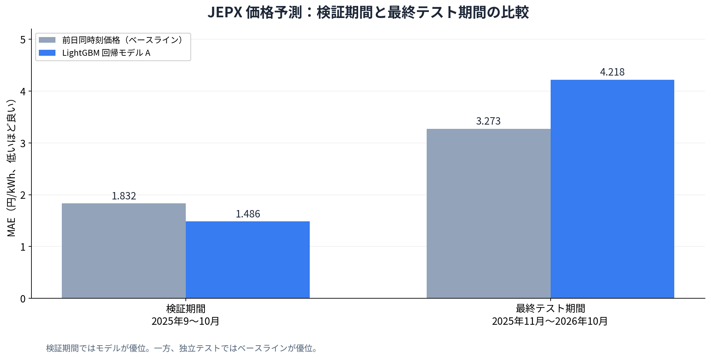
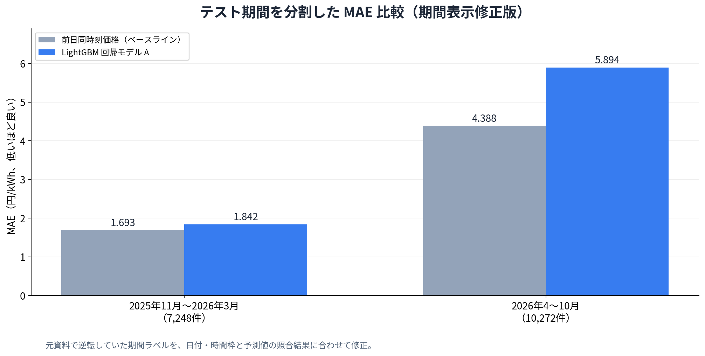
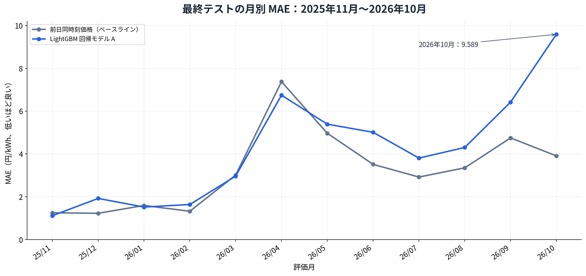

# JEPX 翌日スポット価格予測｜LightGBM 回帰モデル A の評価・検証

> **位置づけ：追加実験／モデル評価の記録（チームの最終採用モデルを示す資料ではありません）**  
> 評価内容の最終確認：2026年11月17日 ｜ 日本語整理：2026年11月18日

## 1. 概要

日本卸電力取引所（JEPX）の**東京エリア翌日スポット価格（30分枠）**を対象に、前日同時刻の価格をそのまま予測に用いるベースラインと **LightGBM 回帰モデル A** を比較しました。検証期間ではモデルが優れていましたが、**未使用の最終テスト期間ではベースラインを下回りました**。

このフォルダは、うまくいかなかった予測結果を隠すのではなく、**検証→独立テスト→期間別・月別の誤差検査→限界の記録**という一連の評価を示すものです。チームで別途検討した **Extra Trees 等の最終モデルとは別の回帰実験**です。両者を同一モデルの性能とみなさないでください。

## 2. 主な結果（MAE：低いほど良い）

| 評価期間 | 件数 | 前日価格ベースライン | LightGBM A | 結果 |
|:--|--:|--:|--:|:--|
| 検証：2025年9〜10月 | 2,928 | 1.832363 | **1.485678** | A が約18.92%改善 |
| テスト：2025年11月〜2026年3月 | 7,248 | **1.692929** | 1.841817 | A が悪化 |
| テスト：2026年4〜10月 | 10,272 | **4.388192** | 5.894347 | A が悪化 |
| **テスト全体：2025年11月〜2026年10月** | **17,520** | **3.273166** | **4.217821** | **A が約28.86%悪化** |

- MAE = 平均絶対誤差（ここでは価格単位に合わせた **円/kWh**）。**小さい値ほど予測誤差が小さい**ことを示します。
- テスト全体の差は **+0.944655 円/kWh（A − ベースライン）**。
- 検証数値は添付された既存集計表の値です。**テスト17,520件と月別・期間別の集計値は、提供されたテスト予測CSVを別途照合して一致を確認**しています。
- 2025年11月〜2026年3月と2026年4〜10月の数値が逆に説明されていた旧資料を修正しています。

## 3. グラフ

### 検証期間と最終テスト期間

### テスト期間別比較（ラベル修正済み）

### 月別誤差の推移

2026年10月は **A：9.589211／ベースライン：3.910067** で、モデルの誤差が大きくなりました。価格分布の変化などが背景にある可能性はありますが、**グラフだけでは原因を断定できません**。

## 4. ファイル一覧

| 分類 | ファイル | 内容 |
|:--|:--|:--|
| 詳細報告 | [TECHNICAL_REPORT_JA.md](TECHNICAL_REPORT_JA.md) | 実験条件・漏洩リスク・修正履歴と制約 |
| Notebook | [notebooks/JEPX_Test_Diagnostics_JA.ipynb](notebooks/JEPX_Test_Diagnostics_JA.ipynb) | 日本語説明・集計整合性・必要に応じた明細再計算 |
| 機械可読データ | [results/FINAL_period_MAE_comparison.csv](results/FINAL_period_MAE_comparison.csv) | 提供された期間別集計、元の列名を維持 |
| 日本語表 | [results/FINAL_period_MAE_comparison_JA.csv](results/FINAL_period_MAE_comparison_JA.csv) | 期間別MAE、日本語列名 |
| 機械可読データ | [results/FINAL_monthly_MAE_diagnostics.csv](results/FINAL_monthly_MAE_diagnostics.csv) | 提供されたテスト予測から月別に再集計 |
| 日本語表 | [results/FINAL_monthly_MAE_diagnostics_JA.csv](results/FINAL_monthly_MAE_diagnostics_JA.csv) | 月別MAE、日本語列名 |
| 図表 | [figures/](figures/) | 日本語表示のPNG図3点 |

機械可読CSVの列名（`baseline_mae` など）は Notebook や他のコードとの互換性のために残し、**閲覧・提出用として日本語列名の別ファイル**を用意しています。

## 5. 実行・再現方法

1. `notebooks/JEPX_Test_Diagnostics_JA.ipynb` を VS Code または Jupyter で開き、セルを順に実行します（Python 3、標準ライブラリ中心）。
2. **同梱の期間別・月別集計から整合性を確認する処理は、追加データがなくても実行できます。** 日本語グラフは同梱のPNGからも確認できます。
3. 17,520件の個票から **MAEを再計算**する場合は、チームから利用許可を得た `BI_2_テスト予測.csv` 形式のデータ（必要列：`date`, `slot`, `y_price`, `baseline_pred`, `y_price_pred`）を、Notebookの案内に従って**自分のPC上にのみ**置いてください。元の韓国語ファイル名のままでも使用できるようにしています。
4. **学習済みモデルの再学習・特徴量生成までは再現できません**。この配布物には元の学習用コード、学習用データ、モデル重みを含めていないためです。

> **公開範囲に注意：** 原票・予測明細（`merged_30min.csv`、`BI_2_테스트예측.csv` 等）は本パッケージに**含めていません**。元データの再配布条件、チーム内の共有ルール、第三者の権利を確認してから公開範囲を決めてください。集計結果であっても、チーム資料の公開許可は別途確認してください。

## 6. 評価方法に関する注意

- 学習時の変数選択と `lag1d` → `lag2d` の置換は**既存の実験報告に記載された内容**であり、このNotebook単体から学習手順を再検証できるわけではありません。
- 実際の予測時点で未公表の情報を使わないことが重要です。JEPXスポット市場の入札締切は、受渡日の前日 **10:00** です。
- 公表済みデータが後日修正される可能性を考慮した完全な **point-in-time 検証は未実施**です。したがって「データ漏洩が一切ない」とは主張していません。
- テスト結果を見てモデルを再選択するとテストの独立性が崩れます。本記録は**モデルAを固定した評価**であり、テストに基づく追加チューニングを示すものではありません。

## 7. 参考資料

- [第2次プロジェクト全体のREADME](../../../README.md)
- [JEPX公式：取引概要](https://www.jepx.jp/electricpower/outline/)
- [JEPX公式：スポット取引の締切時刻（2016年公表）](https://www.jepx.jp/electricpower/news/20160628.html)
- [scikit-learn：Common pitfalls / Data leakage](https://scikit-learn.org/stable/common_pitfalls.html#data-leakage)
- [scikit-learn：TimeSeriesSplit](https://scikit-learn.org/stable/modules/generated/sklearn.model_selection.TimeSeriesSplit.html)
- [LightGBM：LGBMRegressor](https://lightgbm.readthedocs.io/en/stable/pythonapi/lightgbm.LGBMRegressor.html)

*本フォルダは予測精度の成功事例ではなく、モデルの汎化性能と失敗要因を検討するための補助資料です。*
